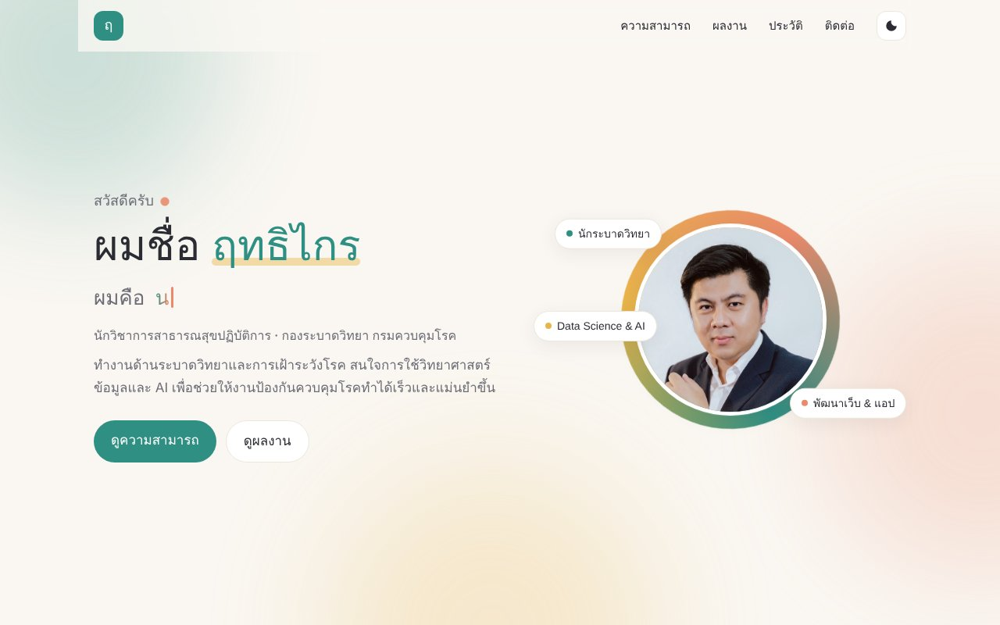
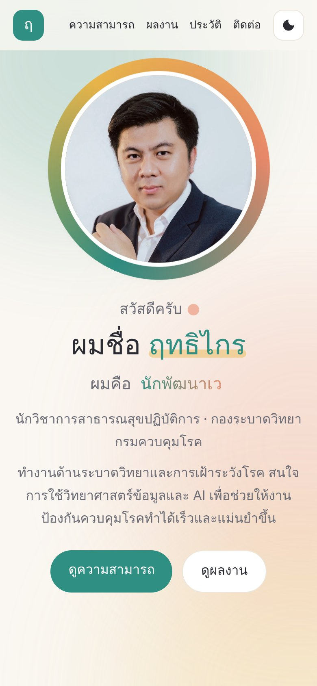

# iboat — เว็บไซต์พอร์ตโฟลิโอ ฤทธิไกร นามเกษ

[](https://app.netlify.com/projects/iboat/deploys)

เว็บไซต์แนะนำตัวและรวมผลงานด้าน **ระบาดวิทยา**, **การพัฒนาเว็บ/แอปด้านสาธารณสุข** และ **Data Science & AI**

🔗 **ดูเว็บไซต์:** <https://iboat.netlify.app>

<p align="center">
  
  &nbsp;
  
</p>

---

## จุดเด่นของเว็บ

- **ไฟล์เนื้อหาไฟล์เดียว** — แก้ข้อความ เพิ่มผลงาน เปลี่ยนลิงก์ ได้ที่ `data.js` โดยไม่ต้องแตะโค้ดส่วนอื่น
- **แอนิเมชันเบา ๆ** — ข้อความพิมพ์สลับ วงแหวนรอบรูปโปรไฟล์ การ์ดค่อย ๆ ปรากฏเมื่อเลื่อนหน้า และกราฟเคลื่อนไหวในการ์ดความสามารถ
- **กรองผลงานตามหมวด** — เว็บแอป, สื่อการสอน, นำเสนอ & รางวัล, บทความตีพิมพ์, รายงาน
- **รองรับมือถือ และโหมดมืด/สว่าง**
- **เคารพการตั้งค่า "ลดการเคลื่อนไหว"** (`prefers-reduced-motion`) ของผู้ใช้
- **ไม่ต้อง build** — HTML / CSS / JavaScript ล้วน ไม่มี framework หรือ dependency

## เทคโนโลยี

| ส่วน | ที่ใช้ |
|---|---|
| โครงหน้าเว็บ | HTML5, CSS (custom properties, grid, keyframes) |
| การทำงาน | Vanilla JavaScript |
| ฟอนต์ | [Kanit](https://fonts.google.com/specimen/Kanit) (หัวข้อ) + [IBM Plex Sans Thai](https://fonts.google.com/specimen/IBM+Plex+Sans+Thai) (เนื้อหา) |
| โฮสติ้ง | [Netlify](https://www.netlify.com/) |

## โครงสร้างไฟล์

```
.
├── index.html        โครงหน้าเว็บ (+ ภาพการ์ตูน SVG สำรอง)
├── style.css         สี ฟอนต์ เลย์เอาต์ แอนิเมชัน
├── app.js            อ่านข้อมูลจาก data.js แล้วสร้างหน้าเว็บ
├── data.js           ★ เนื้อหาทั้งหมดของเว็บ
├── images/
│   └── profile.jpg   รูปโปรไฟล์
├── docs/             ภาพหน้าจอสำหรับ README
└── netlify.toml      ตั้งค่า Netlify
```

## แก้ไขเนื้อหา

เปิด `data.js` แล้วแก้ค่าที่ต้องการ

| ฟิลด์ | ใช้ทำอะไร |
|---|---|
| `name`, `nickname`, `role`, `org`, `intro` | ข้อมูลส่วนหัวของหน้าแรก |
| `photo` | path รูปโปรไฟล์ (ใส่ `""` เพื่อใช้ภาพการ์ตูนแทน) |
| `typer` | คำที่สลับพิมพ์ต่อจาก "ผมคือ…" |
| `highlights` | การ์ดความสามารถเด่น (`featured: true` = การ์ดใหญ่) |
| `categories` | หมวดของผลงาน (ใช้เป็นปุ่มกรอง) |
| `works` | รายการผลงาน |
| `experience`, `education` | ประวัติการทำงาน/การศึกษา |
| `teaching`, `tools`, `training` | หัวข้อบรรยาย เครื่องมือ การอบรม |
| `links` | ช่องทางติดต่อ (ช่องที่ `url` ว่างจะไม่แสดง) |

### เพิ่มผลงานใหม่

คัดลอกบล็อกนี้ไปวางใน `works` (ผลงานที่อยู่บนสุดจะแสดงก่อน)

```js
{
  title: "ชื่อผลงาน",
  category: "app",          // app | media | talk | paper | report
  text: "คำอธิบายสั้น ๆ 1–2 บรรทัด",
  year: "2026",             // ไม่บังคับ
  badge: "",                // ไม่บังคับ เช่น "รางวัลชนะเลิศ"
  tags: ["แท็ก1", "แท็ก2"],
  youtube: "",              // ไม่บังคับ: ใส่ video ID เพื่อแสดงภาพปกคลิป
  link: "https://...",      // ไม่บังคับ: มีปุ่มเปิดลิงก์
},
```

### เปลี่ยนสีธีม

แก้ตัวแปรที่ส่วนบนสุดของ `style.css` เช่น `--accent` (สีหลัก), `--coral`, `--sun`

## ดูเว็บบนเครื่องตัวเอง

ดับเบิลคลิก `index.html` เปิดในเบราว์เซอร์ได้ทันที หรือรันเซิร์ฟเวอร์เล็ก ๆ

```bash
python -m http.server 8000
# แล้วเปิด http://localhost:8000
```

## Deploy

เชื่อม repo นี้กับ Netlify ครั้งเดียว: **Netlify → โปรเจกต์ iboat → Project configuration → Build & deploy → Link repository**
ไม่ต้องตั้ง build command (publish directory = `.`) — หลังจากนั้นทุกครั้งที่ push ขึ้น branch `main` เว็บจะอัปเดตเอง

## สิทธิ์การใช้งาน

- **โค้ด** (HTML / CSS / JavaScript) — ใช้สัญญาอนุญาต [MIT](LICENSE) นำไปปรับใช้เป็นเว็บของตัวเองได้
- **เนื้อหาและรูปภาพ** (ข้อความใน `data.js`, รูปใน `images/`) — สงวนลิขสิทธิ์ © ฤทธิไกร นามเกษ กรุณาเปลี่ยนเป็นข้อมูลของตัวเองก่อนนำไปใช้
